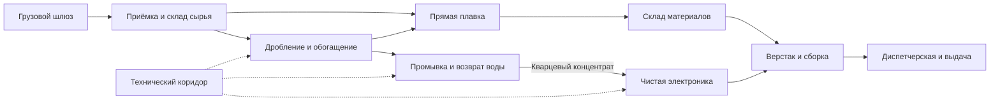

# Проект заводской части Eclipse

Завод снабжает станцию материалами, инструментами и оборудованием. Он входит в инженерный отдел и примыкает к грузовой приёмке. Смена начинается с ручной переработки и первого верстака. Дальше экипаж автоматизирует востребованные операции и решает, куда вложить ресурсы после первой поставки. Планировка и состав стартового оснащения ниже предложены для трёхчасовой смены. [Условия смены](development-roadmap.ru.md#зафиксированные-условия-смены)

## Цеха и планировка

Приёмку разместить у грузового шлюза, выдачу — рядом с диспетчерской на стороне общего коридора. Между ними идут рудный, плавильный и сборочный участки. Вдоль станков нужен проход для обслуживания портов и ручного переноса ящиков. Оставить свободную полосу для расширения линий. Чистый участок разместить за закрываемым входом со стороны сборки, а химический и тепловой узлы вывести к техническому коридору.

| Зона | Оснащение к запуску или при расширении | Что уходит дальше |
| --- | --- | --- |
| Приёмка | Ящики для железа, меди, кварца и угля. Промышленные накопители ставятся при подключении труб. | Отсортированная руда в переработку, образцы в НИО. |
| Механический и плавильный цеха | Места под ручную дробилку и начальную плавильню. При расширении — две дробилки, термоцентрифуга, теплообменник и отвод примесей. | Железо, медь, стекло и материалы для металлургии. |
| Верстак и сборка | Верстак первого уровня, место для сборщика, полки под корпуса, модули и незавершённые партии. | Детали для расширения линии и готовые изделия для отделов. |
| Химический цех | Промывка, ёмкости для чистой воды и отходов, отдельные жидкостные линии для несовместимых потоков. | Концентраты на переработку, восстановленная вода обратно в промывку. |
| Чистый цех | Герметичное помещение с HEPA-контроллером. Первый класс для серийных схем, второй для точной электроники. | Микросхемы, процессоры и продвинутые платы. |
| Диспетчерская и выдача | Терминал производственных заказов, пронумерованные ящики для партий, место для передачи груза карго. | Физические партии по заказам отделов. |

На старте Империя предоставляет инструменты, бумагу, доски и ограниченный запас конструкционных материалов, включая сталь для промышленного ключа и первых изделий. Экипаж строит ручную дробилку, плавильню и верстак через меню «Механизмы». Инструменты и материалы для ремонта хранятся у верстака, готовые партии — у выдачи. [Быстрый старт в игре](../Resources/ServerInfo/Guidebook/Engineering/Industrial/Start.xml)

## Производственные линии

1. **Срочная плавка.** Железная руда идёт в слитки и пластины, медная — в слитки с дальнейшей прокаткой на верстаке или сборщике, кварц — в стекло. Железные пластины идут на корпуса и верстак. Сталь выпускается отдельной металлургической веткой после исследования.
2. **Обогащение.** Приёмный накопитель → дробилка → термоцентрифуга → вторая дробилка → плавильня → склад. В железной ветке одна единица руды даёт две единицы железной пыли и единицу кварцевой пыли. Под нужный объём вторую дробилку и плавильню можно дублировать. На каждом станке закрепляется рецепт, у термоцентрифуги предусматривается отдельный получатель для примеси. Для работы центрифуге нужен нагрев от 400 K.
3. **Оснащение цеха и снабжение.** Верстак выпускает стержни, узлы, чертежи, трубы и первые схемы. После получения данных прикладной электроники базовый сборщик может делать фонарики, малые элементы питания и конфигураторы сетей. Первый заказ на автоматической линии — два фонарика для карго. На каждый нужны по одной единице стали, стекла и листовой меди. Пока НИО готовит диск, на верстаке уже можно выполнить заказ на отвёртки из стартового запаса стали.
4. **Специализация.** Для металлургии развиваются промывка, обогащение и выплавка сплавов. Для электроники — очистка кремния, подготовка пластин и фотолитография. Кремний зонной очистки можно пустить на управляющие ядра ещё до запуска производства процессоров. При стабильном снабжении продуктами ранней линии экипаж выбирает ветку по заказам и доступным исследованиям.

Входные и выходные порты настраиваются промышленным ключом. Буферы между участками позволяют временно перейти на ручную переноску. У приёмки и выдачи отдельные склады, у примесей и отходов свои получатели. При остановке нагрева сырьё из приёмки можно перенаправить на прямую плавку. Теплообменник глубокой линии работает с газовым контуром горячей плазмы, жидкостные трубы обслуживают промывку и химию. Плавильный и сборочный цеха подключить через свои АПЦ, чтобы отключать участки по отдельности. Под нагрузкой сначала проверить одновременную работу плавильни и сборщика. [Линии и подключение](industrial-quick-reference.ru.md) · [Рецепты раннего снабжения](../Resources/Prototypes/_Eclipse/Industrial/early_supply.yml)

## Роли и выдача заказов

| Участник | Работа в смене |
| --- | --- |
| Инженерия | Берёт заявки в работу, закрепляет рецепты, строит линии, проверяет партии перед выдачей. Главный инженер определяет очередность при дефиците ресурсов. |
| Карго и утилизаторы | Добывают или заказывают сырьё, ведут запас на приёмке, забирают готовые ящики и доставляют их отделам. |
| НИО | Изучает образцы и выдаёт обновлённый диск данных. В первую очередь открывает технологию для ближайшего заказа или узкого места линии. |
| Атмосферные техники | Обслуживают нагрев, технологические среды и атмосферу чистого цеха. На малом онлайне это работа инженера. |
| Отдел-заказчик | Указывает изделие, количество и назначение. Подтверждает получение готовой партии после доставки. |

Новая заявка поступает в инженерный терминал. Если требуются сырьё или исследование, инженер указывает в ответе, что нужно и от кого. Статус готовности ставится после проверки содержимого ящика. Карго передаёт ящик, получатель подтверждает выдачу. При 2–14 игроках один инженер может вести приёмку и сборку, а экипаж делит доставку и исследования между доступными сотрудниками. При 15–30 игроках приёмку, изготовление и инфраструктуру ведут параллельно. От 31 игрока полезно дублировать перегруженные линии и назначить отдельного диспетчера из инженерии. [Производственные заказы станции](production-orders.ru.md)

## Развитие за смену

| Этап | Результат, по которому пора двигаться дальше |
| --- | --- |
| Ручной запуск | Выплавлены железо, медь и стекло. Собран первый верстак, начинается выпуск деталей для корпусов. |
| Первая автоматизация | Запущена одна предметная линия. Установлен базовый сборщик, на нужных станках записаны данные НИО. Карго получает первый заказ и подтверждает выдачу. |
| Стабильное снабжение | У цеха есть регулярный поток сырья, запас деталей для ремонта и отдельный отвод примесей. Сборка продолжает выполнять заказы во время расширения. |
| Специализация | По спросу выбраны металлургия, химическая переработка или точная электроника. Промышленный тир добавляется на загруженных операциях. Совершенный тир остаётся целью для смен с достаточными ресурсами и временем. |

На первом плейтесте замерить время от начала смены до первой плавки, старта автоматической линии и подтверждённой выдачи. Отдельно проверить две остановки: потерю нагрева термоцентрифуги и заполнение выхода плавильни. Экипаж должен определить причину каждой остановки, восстановить выпуск и завершить заказ без потери сырья или дублирования продукции. [Карта промышленной прогрессии](industrial-progression.ru.md)
