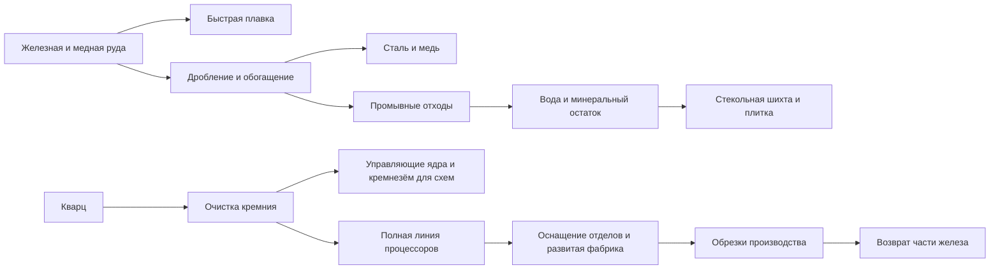

# Проверка и переработка производственных цепочек

28 октября 2026 года. Область: все промышленные и верстачные рецепты Eclipse, производство энергетики, связи с добычей и существующими исследованиями отделов. Штатные протолаты не удалены: их полный перенос и замена на картах остаются отдельной работой.

## Что мешало игре

* У 18 разных механизмов почти совпадали состав и время ручной сборки. Автоматическая сборка многих из них требовала улучшенного сборщика, который сам зависел от ещё не построенной кремниевой линии.
* Механические, управляющие и теплоотводящие узлы занимали по отдельному слоту. Некоторые формально доступные рецепты не помещались в буфер станка.
* У бура и экскаватора совпадали затраты и исследование при существенно разной производительности.
* Водоочистка требовала производственного лома без источника получения. Четыре отработанных раствора не имели применения.
* Быстрая плавка и обогащение давали мало вариантов организации производства. Многие уже существовавшие концентраты и металлургические фракции были не включены в рецепты.
* Бур, экскаватор и собранная защита от перенапряжения могли оказаться в выходном контейнере как непереносимые конструкции.
* Одинаковые дешёвые образцы позволяли бесконечно получать полную научную награду.

## Теперь есть выбор маршрута

| Маршрут железа и меди | Выход с одной руды | Зачем выбирать |
|---|---|---|
| Прямая плавка | 1 слиток | Быстрый запуск, минимум оборудования |
| Дробление → тепловая сепарация → пыль → плавка | 2 слитка и примеси | Первая автоматическая линия |
| Промывка → разделение → термоочистка → печь → отливка | 3 единицы металла и примеси | Экономия руды и угля при большом выпуске; нужны вода, нагрев и несколько механизмов |

Обогащённая железная фракция поступает непосредственно в стальные заготовки. На четыре дроблёных руды расходуется один уголь и получается шесть заготовок. Медная линия даёт шесть медных заготовок из такого же количества дроблёной руды. Побочная продукция железной линии — кварцевая пыль, медной — золотая.

Кварц после промывки и разделения можно направить в кремний или стекольную фракцию. Минеральный остаток промывки служит добавкой для стекольной шихты. Отходы соседних линий становятся сырьём, а не обязательным мусором у каждого начального станка.

## Развитие фабрики

Приводы, управляющие ядра и теплоотводящие узлы складываются по десять. Базовый сборщик по-прежнему имеет четыре входных слота: рецепты первой автоматизации проверяются с этим ограничением.

Первый сборщик способен серийно выпускать модули химической линии. Ручная сборка остаётся стартовым вариантом. Механизмы различаются материалами: пресс использует ткань для фильтров, печи — теплоотводящие узлы, электролизёр — медь, литограф — золото и стекло. Проволочный стан доступен с автоматизацией, литограф и тестер — с точной электроникой.

Совершенные модули требуют совершенных плат; для основных четырёх семейств также нужен жаростойкий сплав. Первые платы по-прежнему изготавливаются на втором верстаке; серийная совершенная сборка даёт две платы за цикл вместо одной.

Бур остаётся первым автоматическим добытчиком. Более производительный экскаватор требует продвинутой автоматизации, промышленного сборщика, плат, процессора и сплава. Оба выпускаются переносимыми комплектами и разворачиваются ключом над жилой.

Алмазный бур действительно требует алмазов. Добавлены редкие проходимые напольные алмазные жилы с конечным запасом, а также промывка алмазной руды. Новые жилы появляются на вновь созданных участках планеты.

## Полезная продукция до конца длинной линии

* После получения кремния зонной очистки базовый сборщик выпускает управляющие ядра партиями по четыре. Не нужно ждать продвинутого сборщика.
* Очищенный кремнезём можно направить в серийные схемы или армированное стекло.
* Промышленный сборщик использует готовый процессор для партии из двенадцати управляющих ядер либо двух высокоёмких элементов питания. Эти маршруты больше не отложены до совершенного тира.
* Медицинский анализатор и газоанализатор доступны базовому сборщику после установки данных соответствующей ранней ветки НИО — «Медицина» или инженерных инструментов.
* Химическая линия выпускает перевязочный материал в чистой комнате, а резак — большие лабораторные стаканы.

35 операций кремниевой линии сохранены. Их назначение — серийный выпуск точной электроники. Промежуточные продукты теперь дают полезные ответвления до последней операции.

## Возврат ресурсов

Угольный фильтр возвращает 16 единиц воды из 20 единиц грязной воды. Шлам обезвоживается в минеральный остаток и каменную пыль; добавленная грязная вода частично возвращается очищенной. Каменные отходы идут в бетонную плитку. Обрезки корпусов микросхем и теплоотводов дробятся и частично возвращаются в железо.

Добавлены переработка отработанного проявителя, возврат воды из легирующего и окислительного растворов, регенерация хлорирующего агента из технологического раствора. Потоки возврата чистые, поэтому их можно подавать обычными трубами без ручного разделения смеси. Регенерация имеет потери и не создаёт замкнутый источник бесконечных реагентов.

Электролизёр может подготовить смесь водорода и кислорода 2:1 для топливного элемента. Это отдельный смешанный поток; чистые технологические реагенты для кремния по-прежнему поступают от химии. С учётом скорости и потребления каждого тира электролиз требует больше энергии, чем возвращает топливный элемент, включая его тепло.

## Связь с НИО

Добавлены образцы технологической очистки и теплового узла. У каждого семейства четыре полезных исследования с наградой 100%, 50%, 33% и 25%. Затем этот материал больше не приносит очков, а экземпляр остаётся у учёного. Учёт общий для станции; замена исследовательского сервера не обновляет награду.

Фабрика помогает научному отделу, но не заменяет работу с аномалиями, артефактами и другими находками. Чистые реагенты, данные отделов и редкая руда поддерживают обмен между специалистами.

## Проверки

Команда `python Tools/industrial/audit_progression.py` проверяет достижимость 313 рецептов, включая производственные станки, тиры, верстаки, чистые комнаты, исследования и растворы. Стартовые материалы и импортируемые реагенты перечислены явно. До совершенных технологий достижимы все 276 относящихся к этому этапу рецептов.

Нативная матрица интеграционных проверок исполнила все 250 станочных рецептов на настоящих механизмах со штатными буферами и отдельно все 63 верстачных рецепта. Проверяются точные входы, выход партии, переносимость продукции и сохранение ванны. Отдельно проверяются отсутствие бесконечного энергетического цикла и убывание научной награды.

Общий профиль производства, исследований и энергетики завершился результатом 125/125 без пропусков.

Это проверка зависимостей и исполнения. Трёхчасовой темп, удобство реальной планировки и интерес нескольких игроков требуют игрового раунда.
