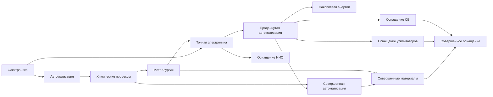

# Промышленная прогрессия Eclipse

Состояние реализации на 28 октября 2026 года. Это карта зависимостей текущих прототипов. Точные количества, время, жидкости, исследования и требования к чистоте перечислены в [каталоге рецептов](industrial-recipe-catalog.ru.md). В игре тот же маршрут доступен в инженерной памятке, раздел «От ручного труда к фабрике».

## Основной маршрут и бюджет времени

Время ниже — **цель баланса для совместной работы отделов**, а не измеренный результат среднего игрока. Трёхчасовой маршрут ещё требует полноценного игрового теста: снабжение, дорога, питание и строительство комнаты обычно занимают больше времени, чем сами циклы станков. Старт предполагает обычные инструменты и ограниченный запас конструкционных материалов станции.

| Этап | Ориентир от начала | Что делать | Что открывается |
|---|---|---|---|
| 1. Сырьё | 0–12 мин | Ручная добыча на астероидах и планете | Руда, напольные жилы, первые геологические образцы |
| 2. Первичная обработка | 12–25 | Построить ручную дробилку и плавильню через «Механизмы» | Железные и медные слитки, пыли, стекло |
| 3. Верстак 1 | 25–35 | Доски, железные пластины, отвёртка | Механические ядра, чертежи, ручные рецепты |
| 4. Первая линия | 35–50 | Поставить чертёж на пол; достроить каркас пластинами и стержнями; установить модуль | Базовые станки, ранние предметные трубы, изготовление запасных ручных инструментов |
| 5. Электроника | 50–65 | НИО изучает электронику и записывает диск; инженер устанавливает данные | Печатные платы, диоксид кремния, стартовые схемы; малые батареи, фонари и сетевые приборы для отделов |
| 6. Автоматизация | 65–85 | Первый сборщик, HEPA-контроллер, исследование автоматизации | Серийные схемы, экструдер, трубы, стационарная добыча; буры утилизаторам, базовые шлемы СБ, радиостанции, посуда и шприцы |
| 7. Химические процессы | 85–105 | Подвести жидкости, организовать расход реагентов и отвод отходов | Промывка, реакторы, химические ванны, фильтрация, ректификация |
| 8. Металлургия | 105–120 | Исследовать металлургию, восстановить железо углём | Сталь, пласталь, жаростойкий сплав |
| 9. Точная электроника | 120–145 | Собрать кремниевую линию; построить чистую комнату класса 2 | Процессоры, продвинутые платы, верстак 2 |
| 10. Развитая фабрика | 145–165 | Исследовать продвинутую автоматизацию и накопители | Промышленный сборщик, эффективные батареи, экспедиционные инструменты |
| 11. Продвинутое оснащение | 165–180 | Выбрать нужные ветки НИО и наладить выпуск | Улучшенное экспедиционное оснащение, продвинутая броня и оружие СБ, сложные приборы НИО |
| 12. Совершенные технологии | После основного маршрута | Исследования высокой стоимости, совершенные платы, чистая комната класса 2 | Совершенные модули, материалы и оснащение |

Тиры станков — **базовый / промышленный / совершенный**. Тиры верстаков — **1 / 2**. Это отдельные шкалы. Этапы таблицы не являются номерами тиров.

## Первые действия без замкнутых зависимостей

1. В категории строительства «Механизмы» доступны ручная дробилка, начальная плавильня и верстак 1. Дробилка выполняет один цикл после ручного действия; оставленная без игрока не работает.
2. Железная руда или железная пыль плавятся в `IndustrialIronIngot`. Плавильня отливает из слитка железную пластину 1:1; на верстаке слиток также превращается в пластину или два железных стержня. Железо отличается от стали.
3. Верстак 1 строится из 6 досок и 4 железных пластин, затем применяется отвёртка. Механическое ядро требует 4 железные пластины и 2 железных стержня.
4. Чертёж корпуса изготавливается из бумаги. Использовать его на свободном тайле, добавить 8 железных пластин и 4 железных стержня, завершить отвёрткой. Установить модуль нужного механизма промышленным ключом.
5. Предметные трубы низкого давления доступны на верстаке. Жидкостные и газовые до производителя труб создаются РСУ: ранняя секция расходует 4 заряда. Штатный РСУ имеет 16 зарядов.
6. Печатная плата изготавливается из меди и стекла. После исследования электроники первые схемные ядра вручную собираются из 2 единиц диоксида кремния и 1 печатной платы. Это стартовая партия для запуска сборщика и очистки помещения; серийное производство схем требует чистой комнаты.
7. Первые продвинутые платы можно изготовить базовым сборщиком в чистой комнате класса 2. Контроллер второго класса собирается на первом верстаке без продвинутой платы. Так первая плата не требует ещё не построенного продвинутого сборщика.
8. Первую совершенную плату собирают на верстаке 2. Затем можно собрать совершенный сборщик и перейти к серийному выпуску.

Медная руда и пыль дают **медный слиток**, затем слиток превращается в лист на верстаке или в сборщике. Медный лист переплавляется обратно 1:1. Все семь базовых пылей используют изображение порошка с оттенком материала.

## Исследования и диски

Схема иллюстрирует ветвление; точные предпосылки каждого исследования заданы в `progression.yml` и показаны в консоли. Завершённая технология сначала появляется в научной базе. Сотрудник с открытой сессией учёного использует диск на запитанной исследовательской консоли либо держит его и нажимает «Записать диск». На диск копируются только уже завершённые исследования.

Инженер использует диск на каждом станке или верстаке. Данные сохраняются в конкретной машине; диск остаётся пригоден для следующих машин. Отключение научного сервера или перенос диска не отнимает уже установленную технологию. После новых исследований диск надо обновить и снова применить к оборудованию.

Консоль оформлена как старый терминал: приглушённый зелёный текст, тонкая развёртка и медленная полоса обновления. Ветки расположены с ответвлениями вверх и вниз. Есть разделы, поиск, перетаскивание за фон, масштабирование колёсиком и кнопками, центрирование выбранного узла и обзор всей схемы. Выделенный узел подсвечивает соседние связи; по завершённым связям проходят небольшие сигналы. Досье показывает предпосылки и переходы к следующим технологиям. Кнопка CRT отключает шейдерные эффекты без изменения компоновки.

## Чистые комнаты

HEPA-контроллер должен быть закреплён, запитан и находиться внутри герметичной комнаты. Проверяются стены, закрытые двери и направленные окна. Открытый наружу проход делает помещение непригодным. Проверка ограничена размером комнаты и выполняется раз в две секунды.

| Условие | Класс 1 | Класс 2 |
|---|---|---|
| Предельный размер | 64 тайла | 96 тайлов |
| Требуемая чистота | 80% | 95% |
| Потребление контроллера | 1800 Вт | 3200 Вт |
| Давление | 60–140 кПа | 60–140 кПа |
| Температура | 285–305 K | 285–305 K |
| Загрязнения | Без плазмы, трития и разливов | Те же требования |

После включения чистота растёт постепенно. При утрате условий чувствительный процесс останавливается с сохранением сырья. После восстановления работа возобновляется. В медицине этот же показатель снижает вероятность воздушного заражения, но не лечит болезни и не заменяет обработку ран.

## Жилы и добыча

Жилы — **проходимые напольные залежи**, без твёрдой коллизии. В текущий генератор планеты добавлены небольшие группы железа, меди, кварца, угля, золота, серебра, плазмы, урана и редкие алмазные жилы. Запас конечный и общий для ручной и автоматической добычи.

Кирка добывает единицу за завершённое действие. Бур ставится поверх жилы, закрепляется и запитывается; нужны данные автоматизации. Полный выход, пауза и отсутствие питания останавливают добычу без списания запаса. Бур выдаёт одну единицу за 5 секунд, экскаватор — две за 3 секунды. Более дорогой экскаватор требует продвинутой автоматизации. Добывающие установки изготавливаются комплектами, разворачиваемыми ключом. Новые правила генерации действуют на новых участках/новом раунде, а не превращают уже созданные стены в жилы.

## Длинная линия и поставки

Существующая цепочка из 35 операций развивает кварц в чистый кремний, пластины, легированные заготовки, микросхемы и процессор. В ней используются предметные стадии, расходуемые растворы, возвращаемые жидкости и химические ванны с сохраняемой средой. Химические стадии требуют своей ветки НИО, точные поздние стадии — точной электроники и чистой комнаты. Для базовых слитков эта линия не нужна.

| Отдел | Поставляет фабрике | Получает |
|---|---|---|
| Утилизаторы | Руду, местоположение жил, найденные материалы | Инструменты, батареи, буровое оснащение |
| НИО | Исследования на дисках | Образцы, сканеры, производственное оборудование |
| СБ | Запрос на нужное оснащение, согласование оружейных исследований | Композитную броню, точные лазерные карабины |
| Медицина | Требования к чистым помещениям | HEPA-контроллеры и инфраструктуру чистоты |
| Атмосфера и уборка | Подходящий воздух и отсутствие разливов | Материалы и оборудование для поддержки помещений |

Геологические, металлургические, электронные, химические и тепловые образцы дают при первом изучении 750 / 1500 / 2500 / 1000 / 1800 очков. Повторные исследования той же серии дают половину, треть и четверть награды, затем прекращают приносить очки. Учёт общий для станции. Это дополнительный поток научных данных вместе со штатной работой НИО.

## Границы текущего переноса

Обычные станционные предметы, старые латовые рецепты и уже размещённые устройства не удалены массово. Новая производственная ветка и специальное оснащение используют фабрику и диски; полный перенос всего каталога SS14 с протолатов требует отдельного прохода по картам и штатным рецептам. Трёхчасовой темп пока является проектной целью. Автоматические проверки подтверждают достижимость маршрута и отсутствие циклических зависимостей, но не заменяют игровую сессию с несколькими отделами.

## Доступ к научной сети и карта исследований

Учётные записи создаются автоматически при прибытии сотрудника. Глава НИО получает бумажный реестр и выдаёт каждому его логин и пароль. Реквизиты поздно прибывших приходят главе НИО в почту КПК; капитану и главе персонала личные реквизиты доставляются туда же. Обычная учётная запись позволяет читать научную базу и почту, научная — проводить исследования, руководящая — управлять доступом.

Карта разделена на производство, инженерию, медицину, робототехнику, экспериментальные технологии, добычу, снабжение, сервис и вооружение. Их корневые исследования зависят от подходящих производственных этапов. Отдельные старые исследования батарей и экспедиционного оснащения объединены с электроникой, накопителями и снабжением утилизаторов; стартовые инструменты не требуют изучения.

Командная строка позволяет искать технологии, смотреть всю цепочку, ставить исследования в очередь и проверять другие терминалы. Команда `help` открывает справочник с примерами; [подробная памятка](research-terminal.ru.md) описывает команды и права. Очередь использует обычные очки и предпосылки, без скидок или обхода исследований. Анализ приносит ограниченную общую награду за технологию.

В настройках интерфейса есть открытие поддерживаемых окон на весь экран приложения. Исследовательская консоль учитывает этот параметр сразу.

Снабжение начинается на этапах 4–6: инструменты собираются на первом верстаке, электроника даёт малые батареи, фонари и сетевые приборы, автоматизация — обычные буры, шлемы, радиостанции и медицинские расходники. Поздние отраслевые исследования открывают улучшения, а не первую полезную поставку.

## Переработка цепочек 28 октября

[Разбор изменений и варианты линий](industrial-chain-audit.ru.md) описывает обогащение с выходом до трёх единиц металла с руды, переработку отходов, серийный выпуск модулей на первом сборщике и ранние поставки отделам. Полный каталог содержит 313 рецептов. Контрольные проверки исполняют все рецепты через настоящие системы станков и верстаков.
